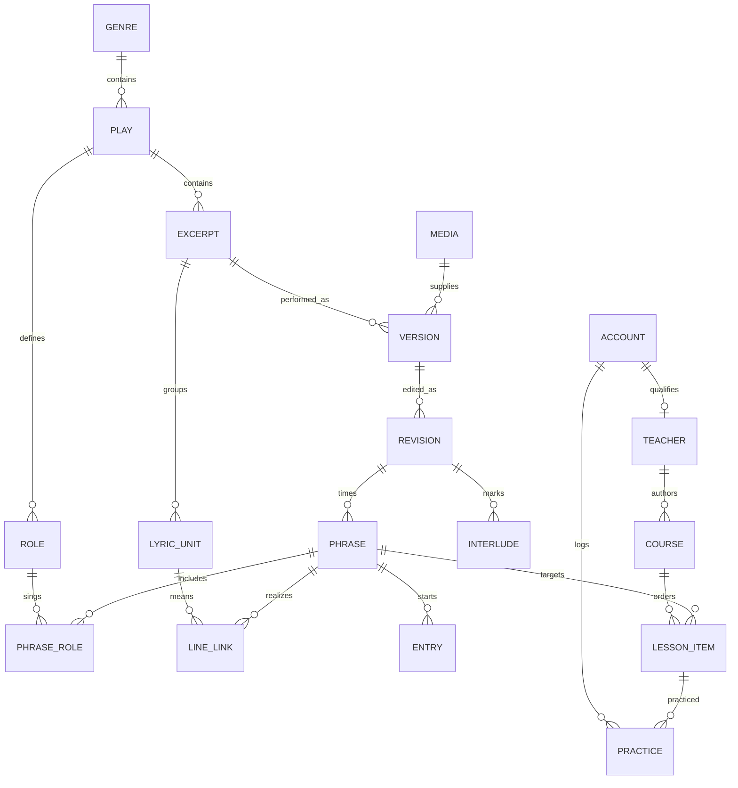

# 实体、时间坐标与修订

**阶段二候选稿。** 核心流程确认后，按入选任务逐项与页面状态、数据权限及技术预研对照，再确认实施范围。

## 核心表字典

以下为逻辑表，id 为主键，带 _id 为外键。账户审计字段含创建、更新时间；媒体、课程、知识条目保留来源。落库前需用实际唱本检查拆并句和角色重叠。

|表|关键字段及关系|约束 / 索引|
|---|---|---|
|genre / play / role|剧种名、别名；剧目.genre_id；角色.play_id、角色名、行当|同名剧目按剧种区别；行当与剧中人物分字段|
|excerpt|play_id、段名、介绍、教学难度|段名仅展示；目录索引 play_id|
|lyric_unit|excerpt_id、教学词本、语义次序、异文说明|跨版本共享的语义单位，无起止秒数|
|media|私有对象键、哈希、类型、时长、采样率、派生关系、偏移、处理状态|同一主体内按哈希去重；许可独立判断|
|rights_grant|权利人、凭证键、用途、地域、受众、起止、撤回、署名、授权对象|权属链可多份；全部必要许可有效才放行|
|version|excerpt_id、media_id、演唱者署名、流派及证据、来源、录制日期|未知字段可空；媒体及版本经关联表绑定相关许可|
|revision|version_id、parent_id、序号、状态、编辑者、锁版本|版本内修订号唯一；发布后不可变|
|phrase / phrase_role|revision_id、顺序、start_ms、end_ms、actual_text、听辨提示；phrase_id、role_id|0 ≤ start < end ≤ 媒体时长；多角色允许重唱；不可推定相邻句无空隙|
|line_link|unit_id、phrase_id、出现次序、对应类型、老师确认、局部词序|多对多；单元与乐句须同唱段；无对应行可表示未映射，另记经确认的缺句状态|
|interlude|revision_id、起止、类型、老师说明、可选目标乐句|器乐区间独立存在，连续多段可指向同一后续句|
|entry|phrase_id、role_id、参考时刻、容许下上界、判据说明、可评价标识|窗口含参考时刻并在媒体内；弱起可跨乐句切点，预听范围须覆盖整窗|
|account / teacher|账号、状态、身份标志；teacher.account_id、资质核验状态、署名|教师外键唯一，公开署名与登录凭证隔离|
|class / membership|班级、任课人、账号、角色、有效期|唯一班级成员；允许撤销|
|course / lesson_item|教师、班级、审核状态、课程发布快照；course_id、顺序、phrase_id、前导开始|发布快照固定课序、修订及乐句；重发生成新快照，禁止覆盖旧记录|
|practice|account_id、event_uuid、快照课项、时间、动作、可选反馈状态|账号内事件键唯一；记录次数与待练选择，P0 无原声键|
|job / candidate|素材修订、算法/配置哈希、租约、终态；候选类型、区间、采纳状态|幂等任务键唯一；候选与已审标注分表|
|alignment / knowledge / audit|两端修订与锚点对、有效区间；版本适用范围、来源段落、审校；操作者/对象/动作/原因|任一端变更需重审；知识检索先授权；审计单独授权|

## 验证建模的反例（虚构）

同一唱段有词本单元 U1、U2。版本 A 的 U1 唱两次，对应 A1[3000,6000)、A2[7500,12000)，中间有器乐；版本 B 把 U1 和 U2 连唱于 B1[5000,14000)。建四条关系 U1→A1、U1→A2、U1→B1、U2→B1。A 缺 U2 由老师标“本版省略”。切换 A2 到 B 时只保证落在 B1，若未精标词内边界，界面提示“合句，听整句”；不得把 A2 的 7500 ms 当成 B 的入点。老师移动 B1 起点生成新修订，历史练习继续指向原课项，连续对齐需重新审批。撤权独立作用于全部修订。

删除策略：已被课程引用的修订禁止级联物理删除，撤回后只向获准审核人员展示必要记录。用户删除练习时清除个人明细、重算统计；授权到期按合同处理媒体、派生物、备份及索引，保留最小处置记录。

**人工样本的交接。** T2 可用受控表单保存素材哈希、许可编号、修订号、句序及原媒体毫秒、标注与复核签署。进入平台时据此导入并重新核查许可；学员本机原声不随内容迁移。
