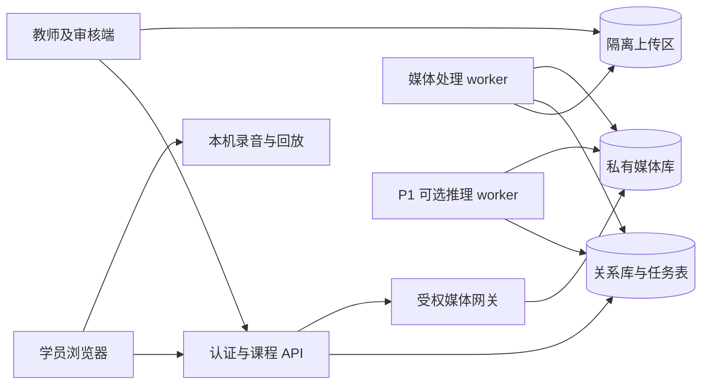

# 候选架构与接口契约

**阶段二候选稿。** 核心流程确认后，按入选任务逐项与页面状态、数据权限及技术预研对照，再确认实施范围。

基于空项目提出的最小部署建议，尚未选定供应商、框架或安装依赖。学员使用移动网页，老师使用桌面网页。建议一个模块化服务、一库一私有媒体桶、一个隔离媒体 worker；先用数据库任务表轮询，达到排队瓶颈再拆消息队列。P0 不依赖推理服务。候选实现为 TypeScript 网页、Python HTTP 服务、PostgreSQL 和兼容对象存储；如团队已有其他技术经验，保留契约即可重新选型。

前端按目录、课程播放器、录音与本机存储、编辑器、审核发布分模块。播放器是媒体时间的唯一来源，UI 动画只读该时钟。老师的编辑缓冲与已发布数据分开。后端按身份与班级、内容与许可、课程、练习摘要、作业执行、审计分模块。推理工人仅凭任务能力令牌读取对应教师素材，无公开上传入口。F08 优先端内运行；离线研究数据和线上用户资料物理分区。

## 媒体生命周期

1. F05 试点建议限 WAV/MP3、单文件 ≤100 MB、解码时长 ≤10 分钟。后端核角色、分配随机对象键并预约额度，签短效单对象上传凭据。客户端文件名仅作显示，不能参与路径解析。
2. 上传完成后验字节数、文件签名、探测音轨与实际解码上限；隔离进程禁出网、限制 CPU、内存、临时盘和运行时长。失败保留原因与草稿，清理隔离对象。成功保存原件哈希、时长和采样率。
3. 转成播放代理与分析用单声道 PCM，提取波形包络。记录编解码前导偏移，以原媒体零点统一标注。派生文件写临时键，完成后事务登记；失败重试不得发布半成品。
4. 学员取流经过鉴权网关，每次新的范围请求校验课、班级、许可、修订与撤回状态；禁止公开桶及永久下载 URL。撤回立即停止新请求，前端停播并清空当前缓冲；已到达设备的数据无法远程回收。
5. 任务状态 queued → running → succeeded / failed / cancelled。以素材哈希、修订、算法版本和配置生成任务键；租约超时可重领，限次指数退避，终态可查。已撤权时丢弃输出。P1 结果进入候选层，由老师显式采纳。

## HTTP 契约（路径均在 /v1 下）

JSON 标识符均为不透明 ID，时间为原媒体整数毫秒、区间左闭右开；服务端不信任客户端的角色、时间或所有者。列表使用 cursor/limit，游标无更多项返回 null。错误为 code、可读消息、request_id 和可选字段错误。

|接口 / 权限|请求要点|成功回包及关键异常|
|---|---|---|
|POST /sessions；DELETE /sessions/current|受邀账号、登录凭证；退出撤销会话|200 当前角色班级；401 凭证失效，429 限速|
|GET /catalog；GET /courses/{id}|班级会话或范围受限试听令牌，剧种/游标|课程摘要或固定修订课序；过期试听令牌 403，下架 410|
|GET /media/{id}/stream|班级令牌及课程上下文、Range|206 授权媒体字节；越权 403，非法范围 416|
|POST /uploads；POST /uploads/{id}/complete|老师，权属档案、大小、类型；完成时带校验值|201 上传凭据；202 处理 job_id；超限 413、类型 415|
|GET /jobs/{id}；POST /revisions/{id}/analyses（P1）|本人授权素材，分析类型、配置|状态/原因；202 候选任务，限额 429；无权读他人任务|
|POST /versions/{id}/revisions；PATCH /revisions/{id}|老师，从指定修订派生或编辑；If-Match、乐句、入点、过门、映射|201 新草稿或 200 新 ETag；412 版本冲突、422 时间越界|
|POST /courses；PATCH /courses/{id}；POST /courses/{id}/submit|老师，班级、课名、有序乐句及冻结修订；送审|201 草稿或 200 状态；无句/许可缺项 422|
|POST /courses/{id}/review；POST /courses/{id}/withdraw|审核员通过/附理由退回；授权管理员或审核员撤回|发布快照及入口或退回理由；409 状态已变，审计有记录|
|POST /practice-events；GET /me/progress；DELETE /me/progress|本人事件 UUID、课程修订乐句、动作；删除需确认|重复键返回原事件，进度分页或 204；不接受音频字段|
|GET /phrases/{id}/alternatives（P1）|有权课程与修订；传目标版本|对应出现及区间或空列表，返回缺句/未审原因|
|GET /classes/{id}/summary；GET /phrases/{id}/notes（P1）|任课老师或相应学员|区间内按句聚合；已审释义与来源|
|POST /questions（P2）|已授权句、问题、检索范围|引用及回答或资料不足；配额超限退回知识卡|

例如 PATCH 草稿可传 {"phrases":[{"id":"p2","start_ms":11000,"end_ms":16000,"actual_text":"例词"}]}，另以同一草稿提交老师确定的入点窗口。媒体长 15000 ms 时回应 422，定位 phrases[0].end_ms，草稿原值保持。重试写入上传、任务和发布请求均携带 Idempotency-Key；同键不同载荷报 409。发布事务锁定课程及权利记录、复验并一次性写快照；检测到修改返回重新预览。

## 身份、运维与成本

邀请加入班级；试听令牌仅绑定相应课程、期限与受众，若合同要求实名范围则须登录。账号采用托管身份或服务端有盐口令哈希、短会话与安全 Cookie，写操作校验 CSRF。按角色加资源归属检查；审核员不能审自己的上传。教师离任撤销授权与会话。媒体、元数据及备份分权加密，密钥在运行时注入。

记录请求与任务 ID、阶段耗时、重试次数、队列年龄、播放错误、授权失败、转码分钟、存储和推理成本。不记录原声、唱词全文、问题全文或令牌。告警建议：连续转码失败、发布越权、失效授权仍能取流立即查；积压超过试点等待预算先暂停分析、保留人工编辑。按班按日设置分钟及金额上限，估算单段成本 = 处理分钟 × 每分钟推理价 + 存储月费 + 分发流量；无正式报价前保留变量。灾备演练从备份恢复元数据、重建代理文件，先叠加撤权/删除清单再开放访问。

**实施边界。** 上述 HTTP 服务供 H1/H2 通过后的平台使用。人工验证期仅需经核准的班级访问、播放与撤回能力；本机进度按作业快照及句号保存，研究员经同意另行登记回访。
